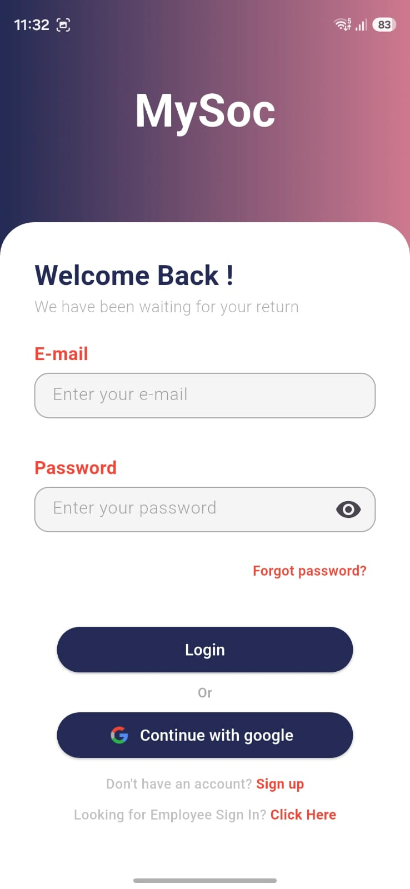
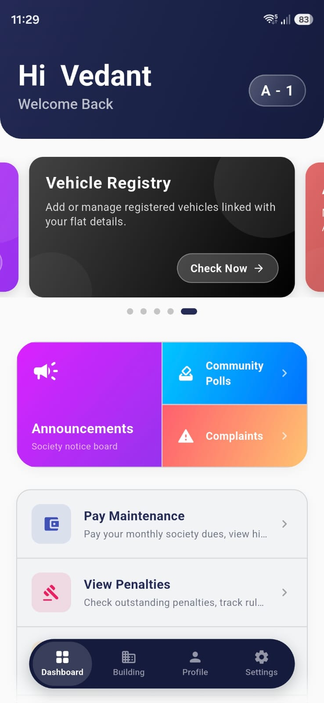
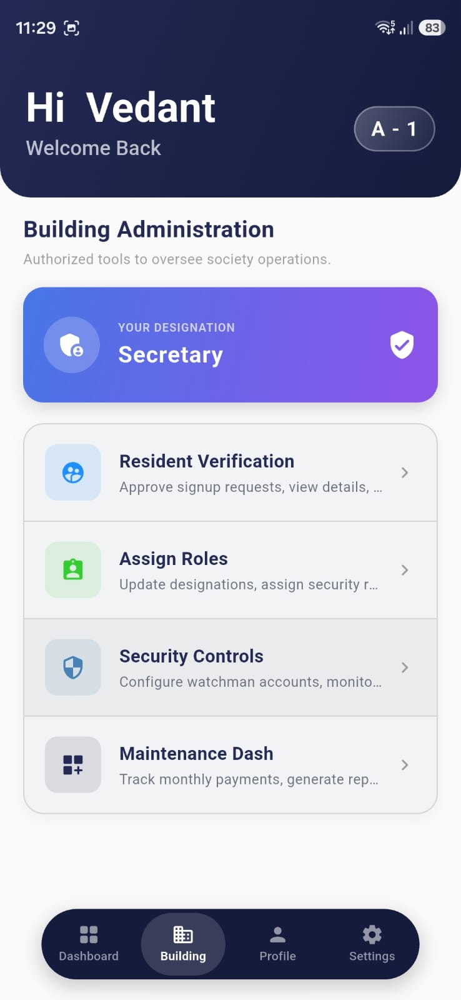
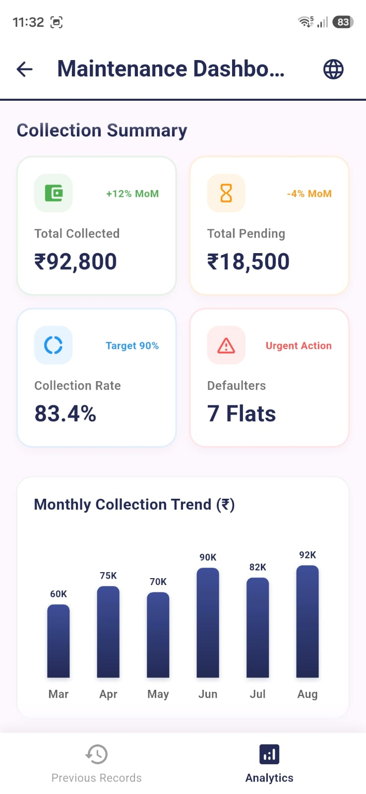
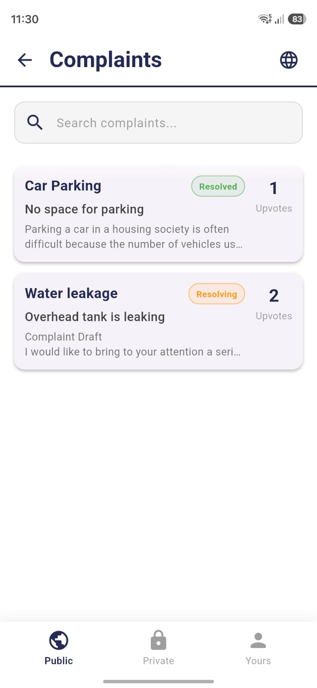
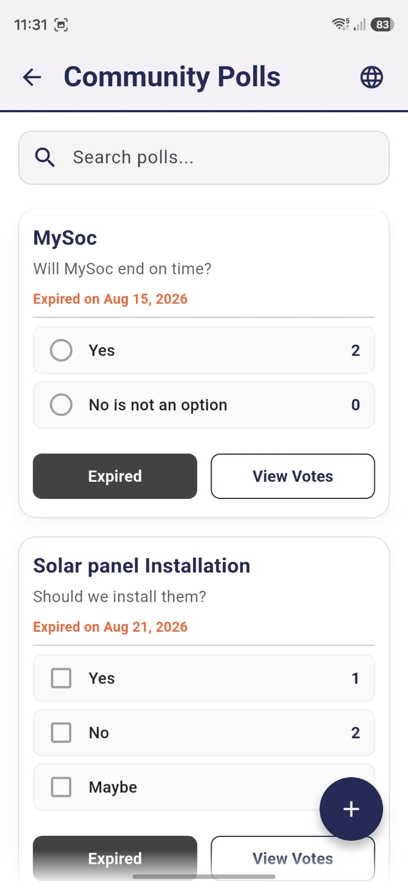
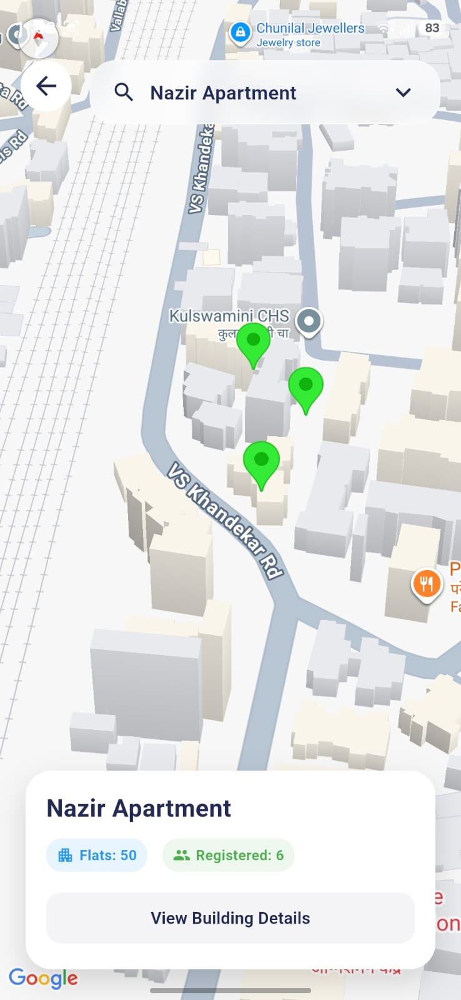
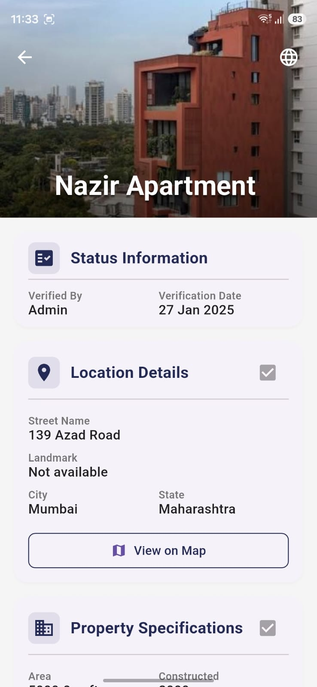

# 🏘️ MySoc — Society Management Application

> A comprehensive Flutter application for digitizing and streamlining residential community operations.

---

## 📋 Table of Contents

- [Description](#-description)
- [Features](#-features)
- [Tech Stack](#-tech-stack)
- [Prerequisites](#-prerequisites)
- [Getting Started](#-getting-started)
- [Project Structure](#-project-structure)
- [Future Scope](#-future-scope)
- [Screenshots](#-screenshots)

---

## 📝 Description

**MySoc** is a full-featured society management application built with Flutter and Firebase. It is designed to streamline residential community operations by replacing manual, paper-based processes with a modern digital platform.

The app caters to multiple user roles — **Secretary**, **Treasurer**, **Security Guard**, and **Resident** — each with tailored access and functionality.

---

## ✨ Features

| Feature | Description |
|---|---|
| 🧾 **Maintenance Bills** | Automated generation and tracking of monthly maintenance bills |
| 📢 **Digital Notice Board** | Post, edit, and delete community announcements with rich media support |
| 📅 **Event Management** | Create events and collect participation through digital forms |
| 👤 **Visitor Management** | Log visitors with resident approval workflow |
| 📊 **Polling System** | Community decision-making through in-app polls |
| 📝 **Complaints System** | Submit and track complaints with file attachments |
| 🔐 **Role-Based Access** | Separate dashboards for Secretary, Treasurer, Security & Residents |
| 📁 **Document Storage** | Encrypted document storage for society records |
| 🗺️ **Location Mapping** | Google Maps integration for location services |
| 💳 **Payment Integration** | Razorpay integration for online maintenance payments |
| 🔔 **Push Notifications** | Firebase Cloud Messaging for real-time alerts |

---

## 🛠️ Tech Stack

| Layer | Technology |
|---|---|
| **Frontend** | Flutter (Dart) |
| **Backend / Database** | Firebase Firestore |
| **Authentication** | Firebase Auth + Google Sign-In |
| **Storage** | Firebase Storage, Cloudinary |
| **Notifications** | Firebase Cloud Messaging |
| **State Management** | Riverpod + Provider |
| **Maps** | Google Maps Flutter |
| **Payments** | Razorpay |

---

## ✅ Prerequisites

Before running the application, ensure you have the following installed:

- [Flutter SDK](https://docs.flutter.dev/get-started/install) `>=3.5.3`
- [Dart SDK](https://dart.dev/get-dart) `>=3.5.3`
- [Android Studio](https://developer.android.com/studio) or [VS Code](https://code.visualstudio.com/) with the Flutter extension
- A physical Android device or Android emulator
- [Firebase CLI](https://firebase.google.com/docs/cli) (for Firebase configuration)
- A Firebase project set up with Firestore, Auth, Storage, and Cloud Messaging enabled

---

## 🚀 Getting Started

Follow these steps to get MySoc running on your local machine:

### Step 1 — Clone the Repository

```bash
git clone https://github.com/your-org/MySoc.git
cd MySoc
```

### Step 2 — Set Up Firebase

1. Go to the [Firebase Console](https://console.firebase.google.com/) and create a new project (or use an existing one).
2. Enable the following Firebase services:
   - **Authentication** (Email/Password + Google Sign-In)
   - **Cloud Firestore**
   - **Firebase Storage**
   - **Firebase Cloud Messaging**
3. Download the `google-services.json` file and place it in the `android/app/` directory.
4. Run the following to configure Firebase:
   ```bash
   flutterfire configure
   ```

### Step 3 — Configure Environment Variables

Create a `.env` file in the root of the project:

```env
CLOUDINARY_CLOUD_NAME=your_cloud_name
CLOUDINARY_API_KEY=your_api_key
CLOUDINARY_API_SECRET=your_api_secret
RAZORPAY_KEY_ID=your_razorpay_key
GOOGLE_MAPS_API_KEY=your_google_maps_api_key
```

> ⚠️ **Never commit your `.env` file to version control.**

### Step 4 — Install Dependencies

```bash
flutter pub get
```

### Step 5 — Run the Application

Connect a device or start an emulator, then run:

```bash
flutter run
```

To run on a specific device:

```bash
# List available devices
flutter devices

# Run on a specific device
flutter run -d <device-id>
```

### Step 6 — (Optional) Build for Release

```bash
flutter build apk --release
```

---

## 📁 Project Structure

```
lib/
├── admin/              # Admin-specific screens and logic
├── authentication/     # Login, registration, and auth flows
├── common/             # Shared modules (homepage, complaints, polls, etc.)
│   ├── announcements/
│   ├── complaints/
│   ├── homepage/
│   ├── members/
│   ├── packages/
│   ├── penalties/
│   ├── polls/
│   ├── sec_maintain/
│   ├── security/
│   ├── vehicles/
│   └── verification/
├── forms/              # Digital forms for events and other submissions
├── pages/              # Role-specific page routing (Secretary, etc.)
├── providers/          # Riverpod providers for state management
├── utils/              # Utility classes (logger, helpers, etc.)
├── watchman/           # Security guard module
├── widgets/            # Reusable UI components
├── firebase_options.dart
└── main.dart
```

## 🔮 Future Scope

- [ ] Multi-language support for diverse communities
- [ ] In-app chat between residents and management
- [ ] Advanced analytics dashboard for Secretary/Treasurer
- [ ] Automated penalty calculation and reminders
- [ ] iOS support

---

## 📸 Screenshots

> *These are just a few glimpses of the application. The full app contains many more screens and features across all user roles.*

### 🔐 Authentication
<p align="center">
  
</p>

### 🏠 Dashboards
<p align="center">
  
  &nbsp;&nbsp;
  
  &nbsp;&nbsp;
  
</p>

### 🧩 Features
<p align="center">
  
  &nbsp;&nbsp;
  
  &nbsp;&nbsp;
  
  &nbsp;&nbsp;
  
</p>

---

<div align="center">
  Made with ❤️ at VJTI
</div>